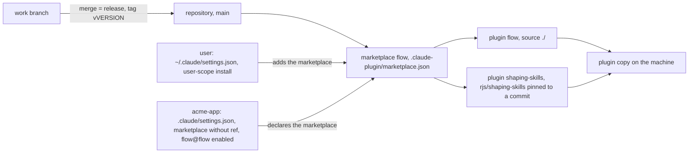
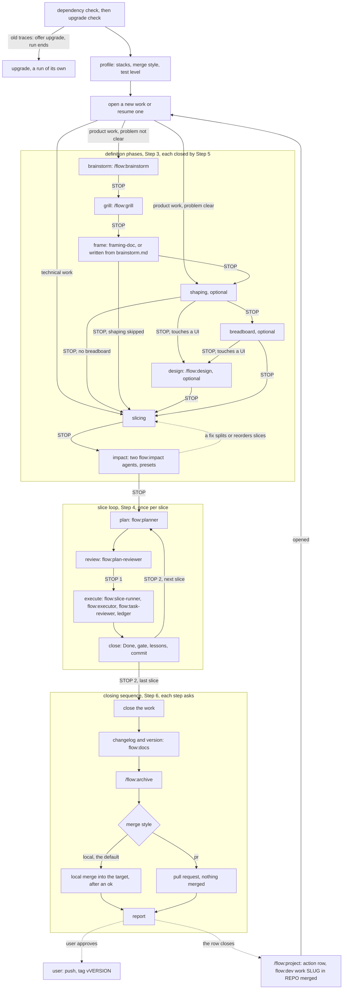
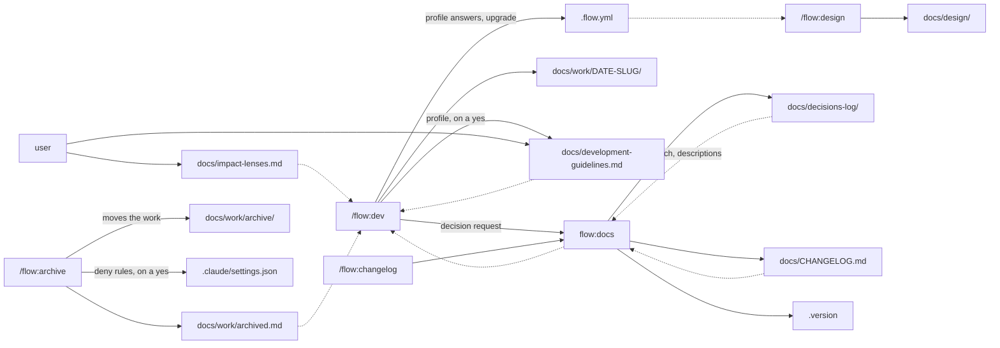
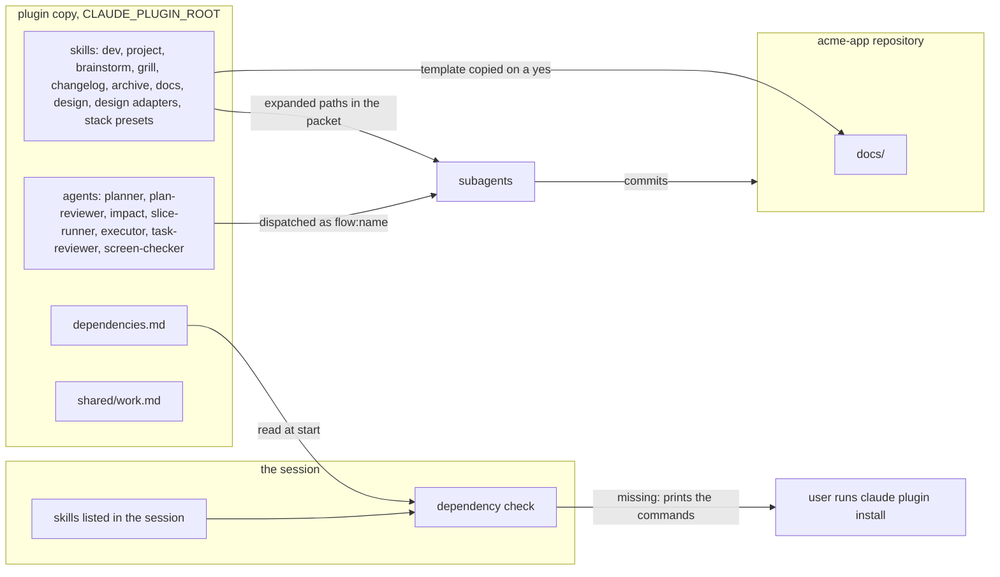

# Architecture

`flow` is a Claude Code plugin that runs work one slice at a time and keeps its state on disk. `/flow:dev` takes software work in a repository from idea to a branch merged after an ok (locally, or by pull request when configured), and `/flow:project` runs a project that people carry out over weeks or months; `/flow:brainstorm` and `/flow:grill` are the dialogue for an idea that isn't clear, `/flow:design` draws a work's screens or artifacts (from the project's design system, or as a Claude artifact), and `/flow:changelog` and `/flow:archive` close a software work. The conductors run planning, review, impact and execution on Flow's own agents, and hand shaping, breadboarding and framing to the `shaping-skills` plugin, which they check for at start but never install.
The repository, the marketplace and the plugin are all named `flow`.

The skills are the source of truth. This page describes them and links to them; where the two disagree, the skill wins. Plugin skills are invoked as `/plugin-name:skill-name`, hence `/flow:dev` ([skills](https://code.claude.com/docs/en/skills)). Skills that aren't user-invocable (`flow:docs`, the stack presets, the design adapters such as `flow:design-pen`) and Flow's agents are named `flow:<name>`, without a slash.

## Distribution



The repository root is a marketplace: [`.claude-plugin/marketplace.json`](../.claude-plugin/marketplace.json) names it `flow` and lists two plugins ([create a marketplace](https://code.claude.com/docs/en/plugins/create-marketplace)).

- **`flow`** has the source `./`, the marketplace root itself, so the plugin is the repository. Its manifest is [`.claude-plugin/plugin.json`](../.claude-plugin/plugin.json); its skills are under [`skills/`](../skills).
- **`shaping-skills`** points at the GitHub repository `rjs/shaping-skills` and pins it with a full commit `sha`: Claude Code checks out that commit ([plugin sources](https://code.claude.com/docs/en/plugins/marketplace-reference#plugin-sources)). It is listed here so the dependency can be installed as `shaping-skills@flow`; see [the soft-dependency decision](decisions-log/2026-10-25-soft-dependencies.md).

A plugin's install id is the entry name, `@`, and the marketplace name: `flow@flow`. A user installs it once at user scope, which records it under `enabledPlugins` in `~/.claude/settings.json` and makes it available in every project on the machine ([install scopes](https://code.claude.com/docs/en/plugins/install#choose-an-install-scope)). The plugin itself:

```bash
claude plugin marketplace add spleenteo/flow --scope user
claude plugin install flow@flow --scope user
```

The commands of the dependencies are in [`dependencies.md`](../dependencies.md).

A project that adopts the flow commits a `.claude/settings.json` that declares the marketplace and enables the plugin, with no `ref`:

```json
{
  "extraKnownMarketplaces": {
    "flow": { "source": { "source": "github", "repo": "spleenteo/flow" } }
  },
  "enabledPlugins": { "flow@flow": true }
}
```

Why no `ref`, from the docs:

- Each user has one registry of fetched marketplaces, so a marketplace added in one project is available in every project ([loading](https://code.claude.com/docs/en/plugins/loading#check-which-stage-a-plugin-reached)).
- When several settings files define a marketplace under the same name, the entry from the highest-precedence file is used whole ([`extraKnownMarketplaces`](https://code.claude.com/docs/en/settings-reference#extraknownmarketplaces)), and project settings sit above user settings ([precedence](https://code.claude.com/docs/en/settings#settings-precedence)).
- When a declared marketplace's source changes in settings, Claude Code re-fetches it ([loading](https://code.claude.com/docs/en/plugins/loading#check-which-stage-a-plugin-reached)).

So a project `ref` overrides the user's entry, and two projects on different tags make the single copy re-fetch at every switch. Projects declare the marketplace without `ref`, and `main` holds released states only: [projects declare the marketplace without a ref](decisions-log/2026-10-25-projects-declare-marketplace-without-ref.md). A project that must stay behind can still set `ref` as an escape hatch.

What a teammate gets from that file: the marketplace is registered only after they accept the workspace trust dialog for the folder ([`extraKnownMarketplaces`](https://code.claude.com/docs/en/settings-reference#extraknownmarketplaces)). A plugin enabled only in project settings is not fetched onto a machine where it isn't installed, unless its marketplace entry has a relative-path source, as `flow` does ([enabled in project settings but not installed](https://code.claude.com/docs/en/plugins/loading#enabled-in-project-settings-but-not-installed)). The dependencies are not enabled by the file; the start check tells the teammate what to install ([Where the plugin ends](#where-the-plugin-ends)).

Releases: work happens on branches, and a merge into `main` is a release, tagged `vVERSION` (the content of `.version`) on the merge commit. The rules are in [`development-guidelines.md`](development-guidelines.md#releases). Third-party marketplaces don't auto-update by default; a user picks up a release when the marketplace is updated ([keep plugins updated](https://code.claude.com/docs/en/plugins/install#keep-plugins-updated)).

## The `/flow:dev` lifecycle



Taken from [`skills/dev/SKILL.md`](../skills/dev/SKILL.md) and [`shared/work.md`](../shared/work.md). Solid arrows are what the skill does; dotted arrows are the user's actions or loops back.

- **Dependency and upgrade checks.** The dependency check runs first on every invocation, before any file is written. It reports what's missing in one message and doesn't block the start; each phase checks again and stops if its tool is absent ([Where the plugin ends](#where-the-plugin-ends)). The upgrade check looks on the default branch for traces of the older names; when it finds some, the run offers the upgrade and ends there ([Upgrade](../shared/work.md#upgrade)).
- **Profile.** The stacks, the `merge` style and the test level, read from the checkout, the default branch and the open `work/*` branches. Only a missing piece is asked, in one message with the opening's questions, and nothing is written before the answers. On a first run in a repo the same message settles where the flow writes and offers the guidelines and project lenses templates. Writes go on the work's branch, never on the default branch.
- **Presets.** A stack's preset is a skill (`flow:stack-astro`, `flow:stack-datocms`, `flow:stack-rails`, or the one the project maps) with rules, lenses, a test level, gate commands and references. It is invoked at the profile's proposal, at impact, and once per slice when the packet is built; its rules travel in every packet. `design=<skill>` maps the design adapter the same way. A mapped skill replaces the shipped one entirely: [stack presets are replaceable skills](decisions-log/2026-10-26-stack-presets-are-replaceable-skills.md).
- **Open or resume.** A work whose `phase:` isn't `done` is offered for resume, on its branch. Resuming reloads the standing documents (`STATUS.md`, the frame's criterion, the guidelines that apply, `lessons.md`, the description line of the matching decisions), then what each phase and step needs: the plan's header at review, `shaping.md` and `docs/design/README.md` at `phase: design`, the ledger at execute and close. A ledger holding `## Close draft` sends a resume straight to the close.
- **Definition phases.** The opening's visible-outcome test picks the entry: technical work goes straight to slicing; product work with a clear problem starts at shaping; otherwise it runs the definition path, `/flow:brainstorm` then `/flow:grill` on `brainstorm.md`, then the frame. Shaping and breadboard are optional, and a skipped phase is named with its reason. Design is optional too: offered after shaping (or breadboard) when the work touches a UI or an interactive flow is worth trying, it calls `/flow:design` with the criterion and `shaping.md`, and the corrections it returns are written into `shaping.md`. Each round of edits is checked by `flow:screen-checker` (mid tier) from PNG exports in a scratch folder, so no image enters the main session. Slicing always runs; impact is always proposed, and on a one-slice work the user may skip it. Every definition phase after the dialogue (frame, shaping, breadboard, design, slicing, impact) ends with Step 5: fidelity check against the frame's criterion, commit, `STATUS.md`, decision candidate, stop. Shaping, breadboard and slicing come from `shaping` and `breadboarding` (`shaping-skills`), given the criterion and the path to save to. The frame is `framing-doc` when there is source material; without it, `/flow:dev` writes `frame.md` itself from `brainstorm.md` and the grill's answers. Impact runs two `flow:impact` agents (one on a one-slice work) on `slices.md` against the real code.
- **Slice loop.** Per slice, a packet is built once and put at the top of every prompt: the criterion, the slice's section, `lessons.md`, the test level and guidelines, the matching decisions, the project lenses and the presets' rules. `flow:planner` writes the plan and `flow:plan-reviewer` reviews it, then the **first stop**. The packet is written to `V<n>-packet.md`, and `flow:slice-runner` runs the slice in the background: `flow:executor` carries out the tasks (independent ones in parallel), each checked by `flow:task-reviewer`, with fix rounds and rulings recorded in the ledger the runner writes. The runner verifies the Done and the gate and drafts the narrative and lessons; the conductor runs the items left pending with the user, copies the draft and commits, then the **second stop**. Where nesting is unavailable the conductor runs the loop itself. Tiers: planner, plan reviewer, impact and the slice runner on the top tier; executors and task reviews on the mid tier, with a `critical` task's review, the final review and a third fix round on the top tier. Model and effort per dispatch: [`shared/work.md`](../shared/work.md#agents).
- **Closing sequence.** Close the work, the changelog and version through `flow:docs` (`/flow:changelog` runs the same step by hand), `/flow:archive`, then the merge. Each step asks first. With `merge: local` (the default) the merge into the target branch is proposed and run after an ok; with `merge: pr` a pull request is proposed and nothing is merged. Push and tag each need their own ok. All of it is committed on the work's branch, so code, changelog, version and archived work land on the target in one changeset.
- **Decisions.** When a step discards a real alternative, defers a problem on purpose or will surprise a later reader, the conductor proposes a decision and `flow:docs` writes it only after a yes. The format: [`skills/docs/decisions.md`](../skills/docs/decisions.md).

`/flow:project` ([`skills/project/SKILL.md`](../skills/project/SKILL.md)) has the same skeleton with people as the executor: a home folder outside any repo, a reality check in place of impact, plans of actions. When an action is software, its plan row reads *"flow:dev work `SLUG` in `REPO` merged"*. That work is opened with `/flow:dev` in its repo, in its own session, and the row closes when it is merged. When a slice calls for something people will look at, a plan row can read *"/flow:design: <artifact>"* instead, with the medium and the reason; the user runs it by hand, the row closes when the artifact is approved, and its files go under the top home's `docs/design/`.

## What a project holds



Solid arrows write, dotted arrows read. Everything lives under `docs/` by default. With a `root` in `.flow.yml` the same layout moves under that folder, except `docs/design/`, which stays where it is; `.version` stays at the repo root. `flow:docs` is the memory keeper: a forked skill that runs alone, never asks anything, and is called with a self-contained request. It proposes and writes the changelog and the version, writes, updates and checks decisions, and searches the project's memory.

| Path | Holds | Written by | Read by |
|---|---|---|---|
| `docs/work/DATE-SLUG/` | `STATUS.md` (phase, slice, step, Log), `brainstorm.md`, the definition documents (`frame.md`, `shaping.md`, `breadboard.md`, `slices.md`), one plan, one packet and one ledger per slice (`V1-plan.md`, `V1-packet.md`, `V1-ledger.md`), `lessons.md`, `spike-*.md` | `/flow:dev` and its agents (the planner writes the plan); `/flow:brainstorm` and `/flow:grill` write their file; `/flow:archive` adds `archived:` to `STATUS.md` before the move | `/flow:dev` on resume (standing documents only); `flow:docs` reads `STATUS.md` and `slices.md` for the changelog |
| `docs/design/` | Design files, the HTML sources of Claude artifacts, `README.md` (the index) | `/flow:design`, committed by `/flow:dev`'s design phase | `/flow:design`; `/flow:dev` at `phase: design` |
| `docs/decisions-log/` | One file per decision: context, decision, alternatives discarded, `area` | `flow:docs`, only when the user accepts a decision candidate | `/flow:dev` at opening, impact and every plan review, through `flow:docs` searches; the changelog links them; `/flow:archive` checks they exist |
| `docs/development-guidelines.md` | `## Tests` (level and sensitive areas), `## Gate`, naming, placement | The user; `/flow:dev` offers a draft from the presets, or the template, with the profile | `/flow:dev` in every plan, review, execution and close |
| `docs/impact-lenses.md` | The project's own impact lenses | The user; `/flow:dev` offers the template | `/flow:dev` at impact and every plan review, on top of the common and preset lenses |
| `docs/CHANGELOG.md` | What shipped, by version, with the work slug | `flow:docs` (an existing one is adopted) | `/flow:dev` at opening; `/flow:archive` checks the work is there |
| `docs/work/archived.md` | One row per archived work and where its outcome is | `/flow:archive` | `/flow:dev` at opening |
| `docs/work/archive/` | Finished works | `/flow:archive`, with `git mv` | Nobody: `/flow:archive` proposes `deny` rules for `Read` and `Grep` on it in `.claude/settings.json` |
| `.version` | The application version, one line | `flow:docs` | `flow:docs`, and tools |
| `.flow.yml` | `root`, `stacks`, `merge`, `changelog`, `version_file`, `areas`, `presets`, `design` | `/flow:dev`: the profile's answers, on the work's branch, and the upgrade | `/flow:dev`, `/flow:changelog`, `/flow:archive`, `flow:docs` |

An older configuration file isn't read, and `/flow:dev` no longer reads `stack:` (it reads `stacks:`). `/flow:dev` finds both on the default branch and offers the [upgrade](../shared/work.md#upgrade); `/flow:changelog`, `/flow:archive` and `flow:docs` stop on an older file and point to `/flow:dev`. `install.sh` still reads `stack:`, to detect the stacks.

A decision file has a frontmatter (`kind`: `decision` or `deferral`, `status`, `work`, `area`, `touches`, `description`) and a body of context, decision, alternatives discarded, consequences and when to reopen. A decision is never edited into its opposite: a new one supersedes it, and `flow:docs` records the status.

### Project memory

`docs/` is the project's memory, and `/flow:dev` reads it before writing anything new: the changelog and the archived index at opening, the decisions at opening, at impact and in every plan review, the guidelines in every plan, review, execution and close. It searches through `flow:docs` rather than reading every file: a `search` request with key words returns at most ten `path — excerpt` lines, and `descriptions` returns the description line of each matching decision, from which it reads only the files that matter. `docs/work/archive/` is walled on purpose: `flow:docs` never reads it. The details are in the skill's [Project memory](../skills/dev/SKILL.md#project-memory) section.

`/flow:project` writes nothing in a repo: its home is a folder the user names, with its own `STATUS.md`, `constraints.md`, `decisions/` and slice plans. The top home's `STATUS.md` carries `design:` and `presets:` when set, and the home holds `docs/design/`.

## Where the plugin ends



**Dependencies.** [`dependencies.md`](../dependencies.md) at the plugin root lists the skills Flow hands work to, where each comes from, and the install commands at user and project scope. Flow's agents, its dialogue (`flow:brainstorm`, `flow:grill`) and its memory keeper are in the plugin and need nothing else. What is outside:

- **`shaping-skills`** (required): `shaping`, `breadboarding` and `framing-doc` for the definition phases, and `kickoff-doc` for `/flow:project`. Required for the phase that uses it.
- **Per-stack skills** (optional): the `datocms` plugin for the `stack-datocms` preset, and `rails-development` for `stack-rails`. A row is checked only in a project of that stack.

`/flow:dev` and `/flow:project` read the file at the start of every invocation and compare it with the skills the session lists. A dependency counts as present when a listed skill has its name, or its segment after `:` matches, so a personal copy counts. Anything missing is reported in one message. At the phase that needs a dependency, the check runs again and stops that phase if it's still absent. The plugin never installs anything; the user runs the printed commands. `install.sh` does the same check from the shell for the current repo. Why: [the plugin checks its dependencies at start](decisions-log/2026-10-25-soft-dependencies.md), and [`grill-me` is not a dependency](decisions-log/2026-10-25-no-grill-me-dependency.md); Flow's own engine, [one release](decisions-log/2026-10-26-flow-own-engine-ships-as-one-release.md), [writes and runs its own plans](decisions-log/2026-10-26-flow-writes-and-runs-its-own-plans.md).

**Plugin copy and project.** From a GitHub marketplace, the plugin's files live under Claude Code's plugins root, `~/.claude/plugins/` by default: in the marketplace's clone or in the plugin cache ([plugins on disk](https://code.claude.com/docs/en/plugins/loading#find-plugins-on-disk)). Only a marketplace added from a local path loads its relative-path plugins in place, from that path ([in-place and copied plugins](https://code.claude.com/docs/en/plugins/loading#in-place-and-copied-plugins)). The skills, agents, templates, lenses and `dependencies.md` stay there. The project holds only what Flow writes: `docs/`, `.version`, `.flow.yml`, and the `deny` rules `/flow:archive` adds to `.claude/settings.json`. A template reaches the project only when the user accepts it, and from then on it is the project's file.

**Path variables.** The skills never hard-code where the plugin lives:

- `${CLAUDE_PLUGIN_ROOT}` is the plugin's installation directory, substituted in plugin skills ([string substitutions](https://code.claude.com/docs/en/skills#available-string-substitutions)). The conductors read `${CLAUDE_PLUGIN_ROOT}/dependencies.md` and `${CLAUDE_PLUGIN_ROOT}/shared/work.md` with it. It changes when the plugin updates, so nothing is written there ([environment variables](https://code.claude.com/docs/en/plugins/manifest-reference#environment-variables)).
- `${CLAUDE_SKILL_DIR}` is the directory of the skill's own `SKILL.md`, inside the plugin ([string substitutions](https://code.claude.com/docs/en/skills#available-string-substitutions)). `/flow:dev` uses it for `common-lenses.md` and its templates; `/flow:project` for its constraints template.
- `${user_config.model_top}`, `${user_config.model_mid}` and `${user_config.stack_presets}` (which also takes `design=<skill>`) carry the plugin's options ([user configuration](https://code.claude.com/docs/en/plugins/manifest-reference#user-configuration)); a value that is empty, or still begins with `${`, is unset. Environment variables can override the models and effort: see the README's [Configuration](../README.md#configuration).
- Claude Code substitutes the variables in the skill's own text ([string substitutions](https://code.claude.com/docs/en/skills#available-string-substitutions)), and the plugin variables aren't in the environment of Bash commands, in the session or in a subagent ([environment variables](https://code.claude.com/docs/en/plugins/manifest-reference#environment-variables)). A subagent's prompt is not skill text, so a packet carries expanded absolute paths, never the variables.
