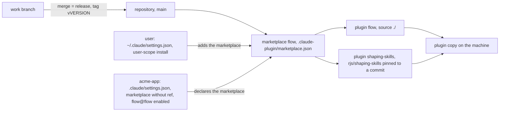
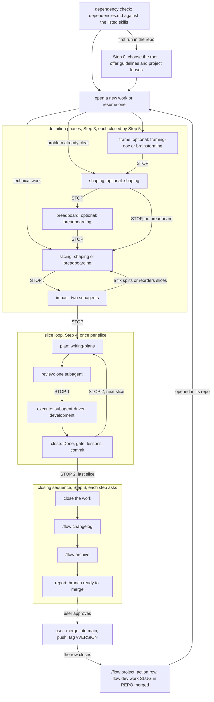
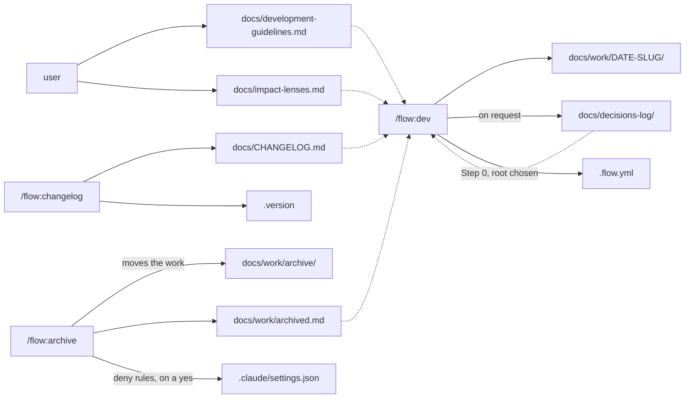
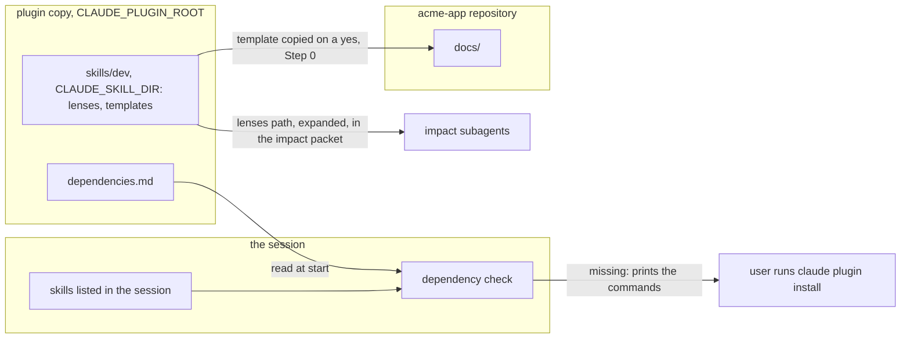

# Architecture

`flow` is a Claude Code plugin that runs work one slice at a time and keeps its state on disk. `/flow:dev` takes software work in a repository from idea to a branch ready to merge, and `/flow:project` runs a project that people carry out over weeks or months; `/flow:changelog` and `/flow:archive` close a software work. The conductors hand the thinking, planning and execution to skills from other plugins, which they check for at start but never install.
The repository, the marketplace and the plugin are all named `flow`.

The skills are the source of truth. This page describes them and links to them; where the two disagree, the skill wins. Plugin skills are invoked as `/plugin-name:skill-name`, hence `/flow:dev` ([skills](https://code.claude.com/docs/en/skills)).

## Distribution



The repository root is a marketplace: [`.claude-plugin/marketplace.json`](../.claude-plugin/marketplace.json) names it `flow` and lists two plugins ([create a marketplace](https://code.claude.com/docs/en/plugins/create-marketplace)).

- **`flow`** has the source `./`, the marketplace root itself, so the plugin is the repository. Its manifest is [`.claude-plugin/plugin.json`](../.claude-plugin/plugin.json); its skills are under [`skills/`](../skills).
- **`shaping-skills`** points at the GitHub repository `rjs/shaping-skills` and pins it with a full commit `sha`: Claude Code checks out that commit ([plugin sources](https://code.claude.com/docs/en/plugins/marketplace-reference#plugin-sources)). It is listed here so the dependency can be installed as `shaping-skills@flow`; see [the soft-dependency decision](decisions-log/2026-10-25-soft-dependencies.md).

A plugin's install id is the entry name, `@`, and the marketplace name: `flow@flow`. A user installs it once at user scope, which records it under `enabledPlugins` in `~/.claude/settings.json` and makes it available in every project on the machine ([install scopes](https://code.claude.com/docs/en/plugins/install#choose-an-install-scope)). The plugin itself:

```bash
claude plugin marketplace add spleenteo/flow --scope user
claude plugin install flow@flow --scope user
```

The dependencies' commands are in [`dependencies.md`](../dependencies.md).

A project that adopts the flow commits a `.claude/settings.json` that declares the marketplace and enables the plugin, with no `ref`:

```json
{
  "extraKnownMarketplaces": {
    "flow": { "source": { "source": "github", "repo": "spleenteo/flow" } }
  },
  "enabledPlugins": { "flow@flow": true }
}
```

Why no `ref`, from the docs:

- Each user has one registry of fetched marketplaces, so a marketplace added in one project is available in every project ([loading](https://code.claude.com/docs/en/plugins/loading#check-which-stage-a-plugin-reached)).
- When several settings files define a marketplace under the same name, the entry from the highest-precedence file is used whole ([`extraKnownMarketplaces`](https://code.claude.com/docs/en/settings-reference#extraknownmarketplaces)), and project settings sit above user settings ([precedence](https://code.claude.com/docs/en/settings#settings-precedence)).
- When a declared marketplace's source changes in settings, Claude Code re-fetches it ([loading](https://code.claude.com/docs/en/plugins/loading#check-which-stage-a-plugin-reached)).

So a project `ref` overrides the user's entry, and two projects on different tags make the single copy re-fetch at every switch. Projects declare the marketplace without `ref`, and `main` holds released states only: [projects declare the marketplace without a ref](decisions-log/2026-10-25-projects-declare-marketplace-without-ref.md). A project that must stay behind can still set `ref` as an escape hatch.

What a teammate gets from that file: the marketplace is registered only after they accept the workspace trust dialog for the folder ([`extraKnownMarketplaces`](https://code.claude.com/docs/en/settings-reference#extraknownmarketplaces)). A plugin enabled only in project settings is not fetched onto a machine where it isn't installed, unless its marketplace entry has a relative-path source, as `flow` does ([enabled in project settings but not installed](https://code.claude.com/docs/en/plugins/loading#enabled-in-project-settings-but-not-installed)). The dependencies are not enabled by the file; the start check tells the teammate what to install ([Where the plugin ends](#where-the-plugin-ends)).

Releases: work happens on branches, and a merge into `main` is a release, tagged `vVERSION` (the content of `.version`) on the merge commit. The rules are in [`development-guidelines.md`](development-guidelines.md#releases). Third-party marketplaces don't auto-update by default; a user picks up a release when the marketplace is updated ([keep plugins updated](https://code.claude.com/docs/en/plugins/install#keep-plugins-updated)).

## The `/flow:dev` lifecycle



Taken from [`skills/dev/SKILL.md`](../skills/dev/SKILL.md). Solid arrows are what the skill does; dotted arrows are the user's actions.

- **Dependency check.** It runs first on every invocation, before any file is written. It reports what's missing in one message and doesn't block the start; each phase checks again and stops if its tool is absent ([Where the plugin ends](#where-the-plugin-ends)).
- **Step 0** runs once, when the repo has no `docs/work/` and no configuration file. It settles where the flow writes and offers the guidelines and the project lenses templates; it creates them only on a yes.
- **Open or resume.** A work whose `phase:` isn't `done` is offered for resume. Resuming reloads the standing documents only: `STATUS.md`, the frame's criterion, the guidelines that apply, `lessons.md`, the description line of the matching decisions, the current plan.
- **Definition phases.** The opening's visible-outcome test picks the entry: product work starts at the frame (or at shaping when the problem is clear), technical work goes straight to slicing. Frame, shaping and breadboard are optional, and a skipped phase is named with its reason. Slicing always runs; impact is always proposed, and on a one-slice work the user may skip it. Every phase ends with Step 5: fidelity check, commit, `STATUS.md`, decision candidate, stop. Each phase hands off to a dependency skill, with the path to save to: `brainstorming` (superpowers); `framing-doc`, `shaping`, `breadboarding` (shaping-skills). Impact runs two subagents (one on a one-slice work) on `slices.md` against the real code.
- **Slice loop.** Per slice: `writing-plans` writes the plan, a fresh subagent reviews it, then the **first stop**. `subagent-driven-development` executes it, the close verifies the Done and the gate, writes lessons and commits, then the **second stop**.
- **Closing sequence.** Close the work, `/flow:changelog` (entry and `.version`), `/flow:archive` (moves the work under `docs/work/archive/`), report. Each step asks first. All of it is committed on the work's branch, so code, changelog, version and archived work land on `main` in one changeset.
- **Outside the skill.** `/flow:dev` doesn't merge, push or tag. The report says the branch is ready to merge; the user does the rest.

`/flow:project` ([`skills/project/SKILL.md`](../skills/project/SKILL.md)) has the same skeleton with people as the executor: a home folder outside any repo, a reality check in place of impact, plans of actions. When an action is software, its plan row reads *"flow:dev work `SLUG` in `REPO` merged"*. That work is opened with `/flow:dev` in its repo, in its own session, and the row closes when it is merged.

## What a project holds



Solid arrows write, dotted arrows read. Everything lives under `docs/` by default. With a `root` in `.flow.yml` the same layout moves under that folder; `.version` stays at the repo root.

| Path | Holds | Written by | Read by |
|---|---|---|---|
| `docs/work/DATE-SLUG/` | `STATUS.md` (phase, slice, step, Log), the definition documents (`frame.md`, `shaping.md`, `breadboard.md`, `slices.md`), one plan per slice (`V1-plan.md`, ...), `lessons.md`, `spike-*.md` | `/flow:dev`; `/flow:archive` adds `archived:` to `STATUS.md` before the move | `/flow:dev` on resume (standing documents only); `/flow:changelog` reads `STATUS.md` and `slices.md` |
| `docs/decisions-log/` | One file per decision: context, decision, alternatives discarded | `/flow:dev`, only when the user accepts a decision candidate | `/flow:dev` at opening, impact and every plan review; `/flow:changelog` links them; `/flow:archive` checks they exist |
| `docs/development-guidelines.md` | Tests, naming, placement, the gate | The user; `/flow:dev` offers the template at Step 0 | `/flow:dev` in every plan, review, execution and close |
| `docs/impact-lenses.md` | The project's own impact lenses | The user; `/flow:dev` offers the template at Step 0 | `/flow:dev` at impact and every plan review, on top of the stack lenses |
| `docs/CHANGELOG.md` | What shipped, by version, with the work slug | `/flow:changelog` (an existing one is adopted) | `/flow:dev` at opening; `/flow:archive` checks the work is there |
| `docs/work/archived.md` | One row per archived work and where its outcome is | `/flow:archive` | `/flow:dev` at opening |
| `docs/work/archive/` | Finished works | `/flow:archive`, with `git mv` | Nobody: `/flow:archive` proposes `deny` rules for `Read` and `Grep` on it in `.claude/settings.json` |
| `.version` | The application version, one line | `/flow:changelog` | `/flow:changelog`, and tools |
| `.flow.yml` | Overrides: `root`, `stack`, `changelog`, `version_file` | `/flow:dev`, only at Step 0 to record a non-default root | `/flow:dev`, `/flow:changelog`, `/flow:archive` |

When `.flow.yml` is absent and a `.devflow.yml` exists, the skills read that instead, with the same keys, and `/flow:dev` suggests renaming it.

The search order and what is read when are in the skill's [Project memory](../skills/dev/SKILL.md#project-memory) section. `/flow:project` writes nothing in a repo: its home is a folder the user names, with its own `STATUS.md`, `constraints.md`, `decisions/` and slice plans.

## Where the plugin ends



**Dependencies.** [`dependencies.md`](../dependencies.md) at the plugin root lists the skills the conductors hand work to, where each comes from, and the install commands at user and project scope. `/flow:dev` and `/flow:project` read it at the start of every invocation and compare it with the skills the session lists. A dependency counts as present when a listed skill has its name, or its segment after `:` matches, so a personal copy counts. Anything missing is reported in one message. At the phase that needs a dependency, the check runs again and stops that phase if it's still absent. The plugin never installs anything; the user runs the printed commands. Why: [the plugin checks its dependencies at start](decisions-log/2026-10-25-soft-dependencies.md), and [`grill-me` is not a dependency](decisions-log/2026-10-25-no-grill-me-dependency.md).

**Plugin copy and project.** From a GitHub marketplace, the plugin's files live under Claude Code's plugins root, `~/.claude/plugins/` by default: in the marketplace's clone or in the plugin cache ([plugins on disk](https://code.claude.com/docs/en/plugins/loading#find-plugins-on-disk)). Only a marketplace added from a local path loads its relative-path plugins in place, from that path ([in-place and copied plugins](https://code.claude.com/docs/en/plugins/loading#in-place-and-copied-plugins)). The skills, their templates, `lenses.md` and `dependencies.md` stay there. The project holds only what the skills write: `docs/`, `.version`, `.flow.yml`, and the `deny` rules `/flow:archive` adds to `.claude/settings.json`. A template reaches the project only when the user accepts it at Step 0, and from then on it is the project's file.

**Path variables.** The skills never hard-code where the plugin lives:

- `${CLAUDE_PLUGIN_ROOT}` is the plugin's installation directory, substituted in plugin skills ([string substitutions](https://code.claude.com/docs/en/skills#available-string-substitutions)). The conductors read `${CLAUDE_PLUGIN_ROOT}/dependencies.md` with it. It changes when the plugin updates, so nothing is written there ([environment variables](https://code.claude.com/docs/en/plugins/manifest-reference#environment-variables)).
- `${CLAUDE_SKILL_DIR}` is the directory of the skill's own `SKILL.md`, inside the plugin ([string substitutions](https://code.claude.com/docs/en/skills#available-string-substitutions)). `/flow:dev` uses it for `lenses.md`, `decisions-log.md` and its templates; `/flow:project` for its constraints template and decision format.
- Claude Code substitutes both in the skill's own text ([string substitutions](https://code.claude.com/docs/en/skills#available-string-substitutions)), and the plugin variables aren't in the environment of Bash commands, in the session or in a subagent ([environment variables](https://code.claude.com/docs/en/plugins/manifest-reference#environment-variables)). A subagent's prompt is not skill text, so the impact packet carries the expanded absolute path of `lenses.md`, never the variable.
